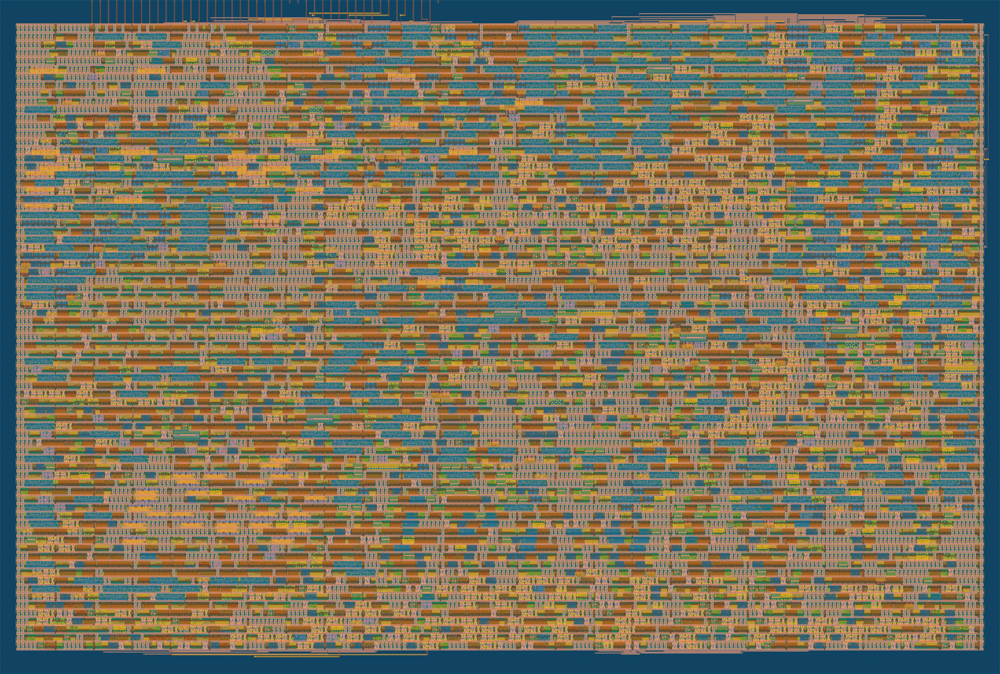

# tt_um_pryzm_cordic — TTSKY26e submission

A 16-bit four-operation CORDIC engine on a 1x2 tile, generated and verified by
**Jaisiu / PhotonIP**. Built to prove the toolchain end to end: model → RTL →
simulation → synthesis → GDS → a design a foundry can actually make.

| | |
|---|---|
| Shuttle | TTSKY26e (`TinyTapeout/tinytapeout-sky-26e`), closes **2026-11-30** |
| PDK | `sky130A` (open_pdks `8afc8346a57fe1ab7934ba5a6056ea8b43078e71`) |
| Flow | LibreLane `3.0.14` (`LIBRELANE_TAG=3.0.0.dev40`) |
| Tiles | **2x2** (334.88 x 225.76 µm die, 75,602 µm²) |
| Top module | `tt_um_pryzm_cordic` |
| Clock | **20 MHz**, closed at every corner |
| Interface | 8-bit byte-serial command/data port on `ui_in`/`uo_out`, handshake on `uio` |

[][viewer]

The routed 2x2 layout, straight from the shuttle's CI. Click the image to open
it interactively in the [TinyTapeout GDS viewer][viewer].

[viewer]: https://gds-viewer.tinytapeout.com/?pdk=sky130A&model=https%3A%2F%2Fpryzmatpl.github.io%2Fttsky26e-pryzm-cordic%2F%2Ftinytapeout.oas

## Why this chip

`tt_um_cordic` (Chirag Kamath) taped out on **this same shuttle** as a 1x1,
987-cell, one-tile CORDIC at 10,581 µm². That is the proof of fit: the class of
design is known to close on sky130A at this tile size, on this run, with the
exact LibreLane version we use. We are not guessing at feasibility — we are
re-implementing a design shape that already passed the shuttle's own CI.

Our variant is larger in function and still small in area:

| Operation | Engine mode | Input | Output |
|---|---|---|---|
| `SINCOS` | rotation | phase word Q2.14 (full turn = 1.0) | sin, cos in Q1.15 |
| `ATAN2` | vectoring | y, x in Q1.15 | angle Q3.13 radians |
| `HYPOT` | vectoring | y, x in Q1.15 | sqrt(x²+y²) in Q1.15 |
| `MUL` | — | a, b in Q1.15 | signed product, Q1.15 |

One adder/shifter datapath serves all four; the multiplier is shared by `MUL`
and the circular-gain compensation. Iterative (not unrolled) over 15 stages, so
the area is one adder plus a 16x16 multiplier rather than fifteen adders.

## What this repository proves

1. **Bit-exact RTL ↔ model.** `./test/run.sh 2000` drives the RTL and the golden
   model with the same stimulus and requires *identical* 16-bit words:
   **9736/9736 exact**. No tolerance.
2. **Numeric conformance.** The model is separately scored against the
   real-valued functions: sin/cos 21 LSB, atan2 28 LSB, hypot 6 LSB, mul 1 LSB
   — all inside the 32 LSB (2^-10) budget.
3. **Full physical closure on sky130A.** LibreLane 3.1: **DRC 0, LVS "circuits
   match uniquely", setup TNS 0 at every corner, hold +0.11 ns, 0 slew
   violations**, GDS streamed (62,362 µm² of cells on a 2x2 die).
4. **Verifiable on the demo board, by hand.** On reset the die runs 41 vectors
   through its own datapath and leaves the verdict on the status pins:
   **LED1 lit = all vectors correct**, LED2 = a mismatch. No host, no laptop,
   no logic analyser. The expected words are generated from the same golden
   model the RTL is proven against (`bringup/gen-selftest-rom.py`), so the
   built-in test cannot drift from the reference.
5. **Re-derivable evidence.** Every number in `docs/evidence/` names the
   command that produced it. `docs/evidence/README.md` §5 lists what is *not*
   claimed.

## Repository layout

```
src/            RTL — project.v (tt_um_pryzm_cordic) and nothing else
test/           cocotb bench, tb.v, Makefile
model/          16-bit golden model (bit-exact reference for the RTL)
docs/           info.md (datasheet text), evidence/, survey of the shuttle
docs/img/       the GDS viewer screenshot used above
```

## Building

The shuttle builds the GDS from the RTL in CI (`.github/workflows/gds.yaml`,
`TinyTapeout/tt-gds-action@ttsky26e`). Locally the same flow is driven by
PhotonIP so the result can be audited before it is submitted:

```bash
photonip design --out runs/cordic-tt --prompt "16-bit unified CORDIC, 1x2, sky130A"
photonip tapeout --out runs/cordic-tt          # G-R1-* readiness audit
photonip signoff --run runs/cordic-tt          # A-E gate table
```

## Honesty contract

This repository does not claim silicon. It claims a manufacturable GDS and the
evidence that produced it. What is **not** claimed is listed in
`docs/evidence/README.md` §5, and it stays listed until an artefact closes it.
